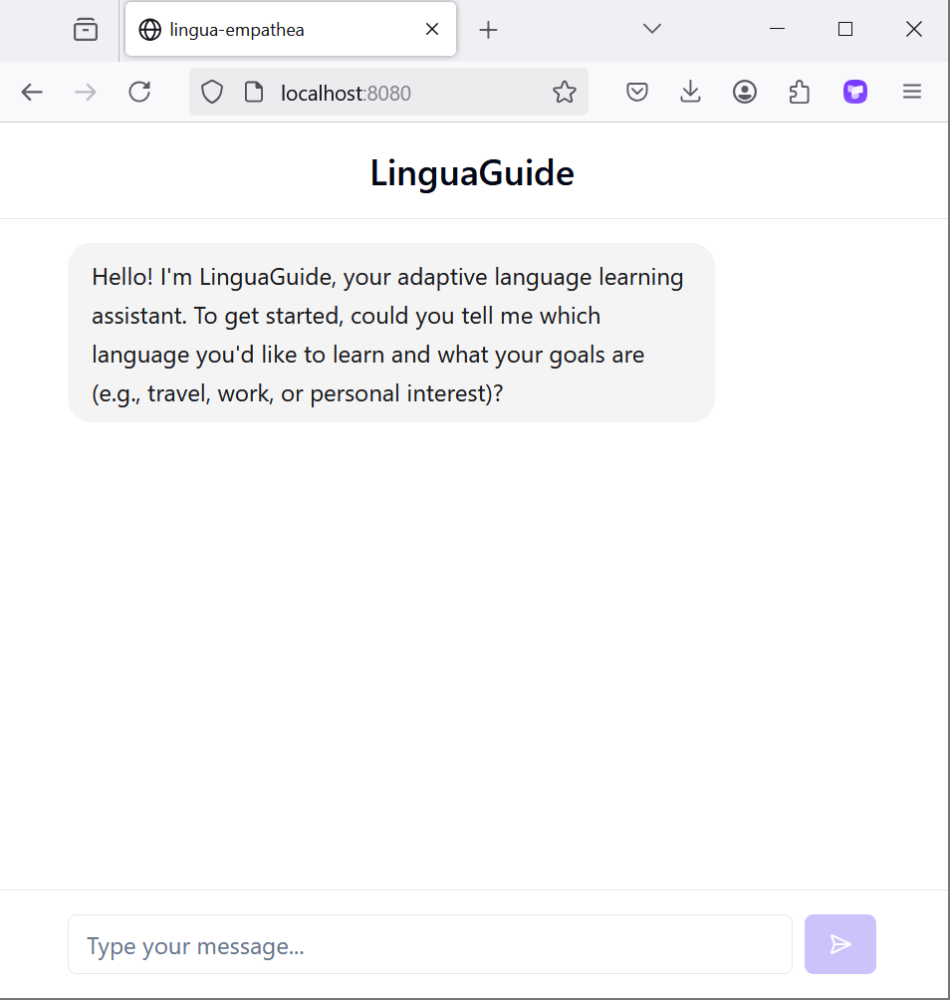
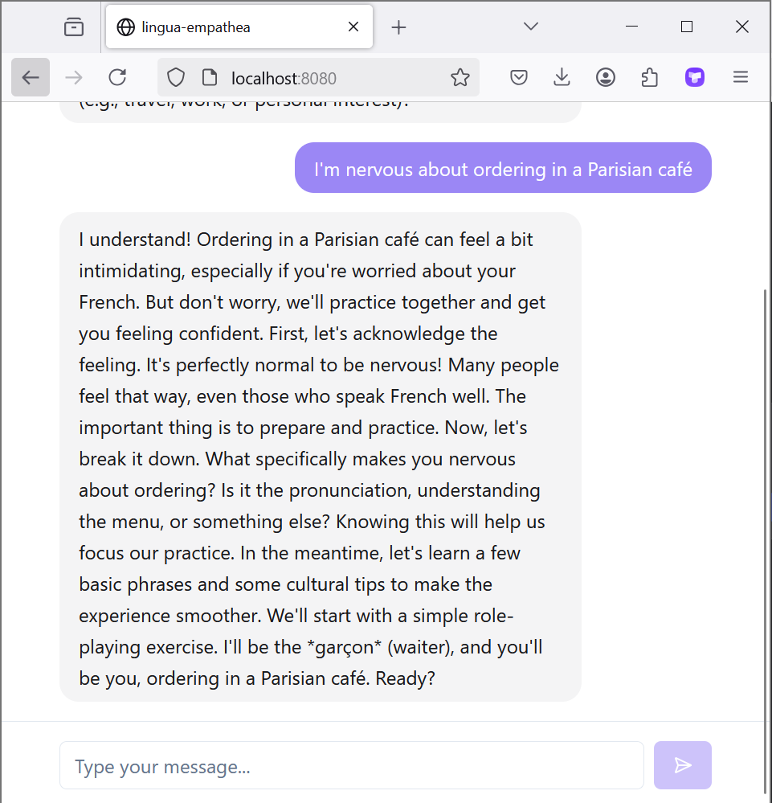
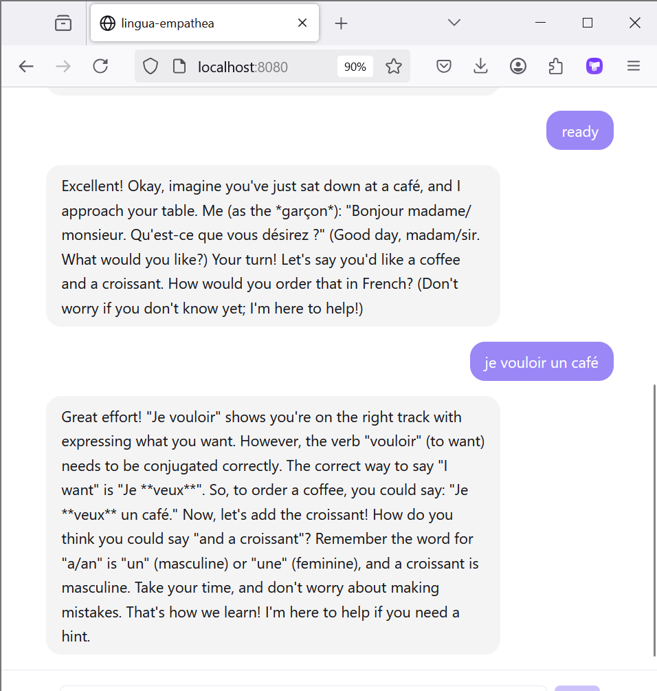

[Build Your Own Chatbot with Gemini API.pptx](https://github.com/user-attachments/files/34632397/Build.Your.Own.Chatbot.with.Gemini.API.pptx)
🚀 Project Setup Guide
📌 Requirements

Ensure you have Node.js and npm installed. If not, you can install them using nvm:
👉 Install with nvm
🔧 Installation Steps

Follow these steps to set up the project:

    # Step 1: Clone the repository using the project's Git URL.
    git clone <YOUR_GIT_URL>

    # Step 2: Navigate to the project directory.
    cd <YOUR_PROJECT_NAME>

    # Step 3: Create a .env file in the root of the project.

    # Step 4: Add your Gemini API key to the .env file.
    # Replace 'your_actual_api_key_here' with the key obtained from Google AI Studio:
    # Get your key from https://aistudio.google.com/

    VITE_GEMINI_API_KEY=your_actual_api_key_here

    # Step 5: Install the necessary dependencies.
    npm install

    # Step 6: Start the development server with auto-reloading and an instant preview.
    npm run dev

Technologies Used

This project is built with:

⚡ Vite – Fast and modern frontend tooling.
🟦 TypeScript – Strongly typed JavaScript for scalable applications.
⚛️ React – Component-based UI framework.
🎨 shadcn/ui – Beautiful and accessible UI components.
🎨 Tailwind CSS – Utility-first CSS framework for responsive design.

Screenshots

